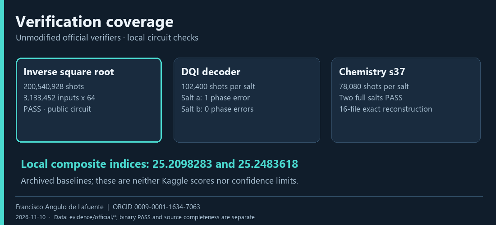

<p align="center"></p>

# QVC Chemistry Compiler

**Reproducible GF(2) angle loaders for the FeMoCo quantum-circuit benchmark.**

Research by **Francisco Angulo de Lafuente** · [ORCID 0009-0001-1634-7063](https://orcid.org/0009-0001-1634-7063) · [Citation](CITATION.cff) · [License policy](docs/LICENSE_POLICY.md)

The selected chemistry achieves a **11.2328903× local cost reduction**, with **14,848 Toffolis and 427 qubits**, checked by the unmodified official verifier. The repository provides the frozen numeric table, a declarative GF(2) plan, source reconstruction and the receipts needed to examine that result. These are classical simulation results for the [Google Quantum AI competition](https://www.kaggle.com/competitions/google-verifiable-quantum-circuit-compilation).

## Measured chemistry


| Verified artifact | Reference/cost | Toffolis | Qubits |
|---|---:|---:|---:|
| Public 24.94 chemistry base | 11.1976101× | 14,966 | 427 |
| Public gengsr chemistry | 11.2040924× | 14,958 | 427 |
| Project s2 | 11.2298650× | 14,852 | 427 |
| **Project s37** | **11.2328903×** | **14,848** | **427** |

The selected result improves the tested gengsr chemistry ratio by **0.2570%**. Two full salts pass at 64 shots per lookup address. error_2 is **19.9784971 mHa**, leaving **0.0215029 mHa** below the 20 mHa ceiling. Comparisons apply to these pinned circuits. [Results and evidence](docs/RESULTS.md).

## How the compiler works


The pipeline fits a credited DF-THC factorization, chooses a Givens tree and 8-bit words, and compiles the lookups with reusable Boolean features. Each emitted loader stays within 128 qubits. Exact reconstruction starts from the saved fitted table and optimized algebraic plan. It checks tensor identities, gauge equivalence and all expected output hashes. [Methods and equations](docs/METHODS.md).

## Reproduce and inspect


```bash
python -m pip install -r requirements.txt
python tools/build_chemistry.py build/chemistry --data /path/to/official/data --runtime /path/to/native/runtime
python tools/verify_local.py chem build/chemistry build/receipt.json --data /path/to/official/data --runtime /path/to/native/runtime
python tools/check_repository.py
```

Use Python 3.13 and the competition's native Kickmix runtime and data. The expected build contains 15 circuits plus one NPZ, byte-identical to the saved manifest. [Full environment and three-task instructions](docs/REPRODUCIBILITY.md).

## Verification coverage



The performance portfolio combines this chemistry with credited public invsqrt and DQI files. The full invsqrt check covers **200,540,928 shots**. Two DQI checks use **102,400 shots each**. Their local composite indices are **25.2098283** and **25.2483618**, using archived baselines. They are not Kaggle scores or confidence bounds. Original receipts and code fingerprints are in [evidence/official](evidence/official).

## A checked primitive experiment


A synthetic measurement-based carry experiment reduces its 32-bit example from **128 to 97 qubits**, retaining **896 Toffolis**. There are **3,344 checks per variant**, with exhaustive small domains and deterministic larger-word cases. This is a primitive result, not an end-to-end QVC gain. [Experiments and negative results](docs/EXPERIMENTS.md).

## Repository map

| Directory | Purpose |
|---|---|
| recipes/s37 | Frozen numeric table, GF(2) masks, pinned source and expected hashes |
| tools | Portable reconstruction, native verification, checks and figure renderer |
| compiler, tables, trees | Project compiler, fitting, rounding and tree-search research |
| experiments, studies | Supporting experiments and diagnostic research scripts |
| vendor | Credited public pipeline and original notices |
| evidence | Original results, executed audit sources and replication records |
| docs | Methods, results, reproducibility, source recovery and attribution |

Research scripts preserve historical names; the documented tools are the portable entry points. [Research contributor](CONTRIBUTORS.md).

## Attribution and open source

Original project contributions: **Francisco Angulo de Lafuente**, [ORCID](https://orcid.org/0009-0001-1634-7063). Please cite [CITATION.cff](CITATION.cff) and retain copyright and license notices when reusing the work. Machine-readable authorship is also provided in [CodeMeta](codemeta.json) and SPDX source headers.

Original, separable project work is **MIT OR Apache-2.0**. The competition handover uses Apache-2.0; Apache-derived code and public components retain their original notices. The project builds on marculera/Lera's pipeline, heliosli's compiler idea and public work credited to qwertykeypadapple, Dmitrii Gluzdov, gengsr, maoxin123, Syed Asad Ali, Atakan Aldemir and other authors. [Full attribution](docs/ATTRIBUTION.md) · [NOTICE](NOTICE).

## Observations

**I01 remains open for the optimized performance portfolio:** the exact original invsqrt/DQI generators have not yet been recovered. Binary verification and an exact-source build are separate acceptance tests. The repository also contains an executable **source-complete control** with organizer-reference invsqrt/DQI, whose local composite is approximately **2.239566**. That control does not close optimized I01. [Source-recovery evidence](docs/SOURCE_RECOVERY.md).

Chemistry reconstructs exactly from saved inputs; deterministic retraining from the Hamiltonian is not established. The animations are rendered scientific illustrations of saved results or labelled schematics. No final Kaggle submission, prize eligibility or hardware performance is claimed. [Competition and publication record](docs/COMPETITION.md).


---
Research author: **Francisco Angulo de Lafuente** · [ORCID](https://orcid.org/0009-0001-1634-7063) · 2026-11-10.
Own text: MIT OR Apache-2.0; third-party materials retain their notices.

<!-- author-background:start -->
## Author background

**Francisco Angulo de Lafuente**, independent AI researcher · [ORCID](https://orcid.org/0009-0001-1634-7063) · [arXiv](https://arxiv.org/a/angulodelafuente_f_1.html) · [Google Scholar](https://scholar.google.com/citations?user=6nOpJ9IAAAAJ) · [ResearchGate](https://www.researchgate.net/profile/Francisco-Angulo-Lafuente-3) · [Figshare](https://figshare.com/authors/Francisco_Angulo_de_Lafuente/22601234) · [Wikipedia](https://es.wikipedia.org/wiki/Francisco_Angulo_de_Lafuente)

Earlier research at ECOFA focused on biotechnology for clean energy and on second-generation biofuels obtained by microbiological processing of organic waste. Two Spanish patents document that work:

- **ES 2273594 B1**, *Process for obtaining fuels from organic waste*. Filed 5 September 2005, grant published 16 February 2008. [OEPM](https://www.oepm.es/pdf/ES/0000/000/02/27/35/ES-2273594_B1.pdf) · [Google Patents](https://patents.google.com/patent/ES2273594B1/en)
- **ES 2341194 B1**, *Method for obtaining paraffin by a biological process with microorganisms from organic matter, and its refining for use as fuel*. Filed 11 September 2007, grant published 26 April 2011. Also published as EP2196519 and WO2009034217. [OEPM](https://www.oepm.es/pdf/ES/0000/000/02/34/11/ES-2341194_B1.pdf) · [Google Patents](https://patents.google.com/patent/ES2341194B1/en)

These are historical publication and grant records under the inventor name Francisco Angulo Lafuente, and both have since lapsed. They are cited as evidence of a research trajectory and make no statement about current enforceability.
<!-- author-background:end -->
