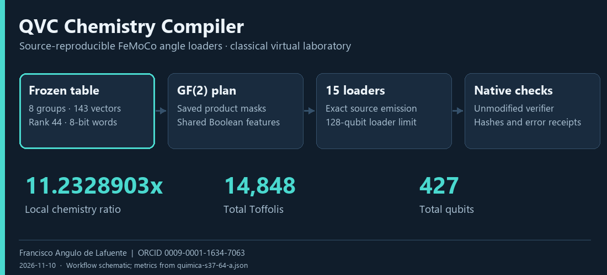
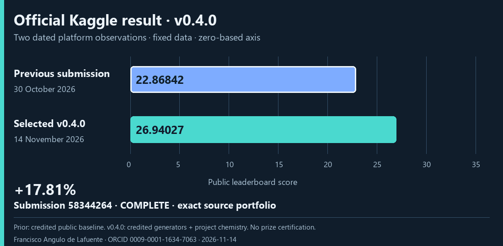
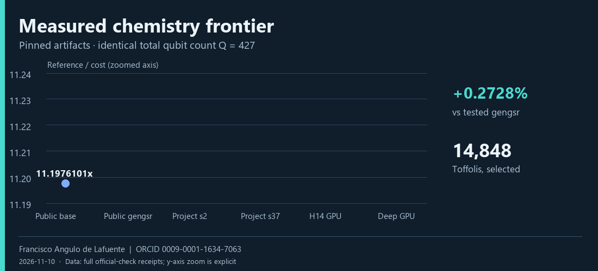
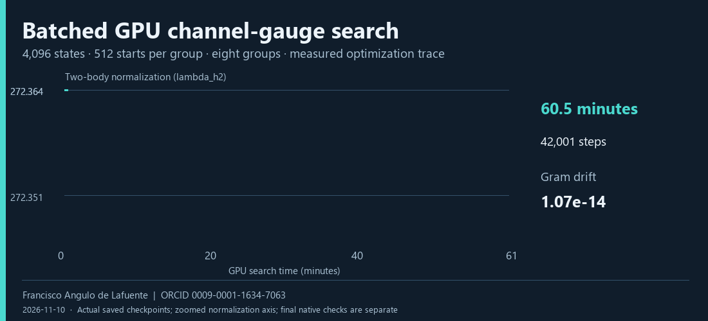
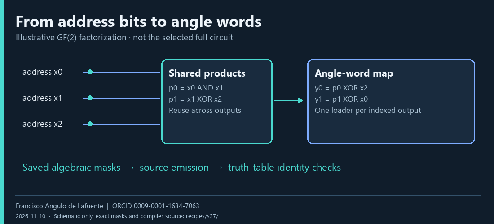
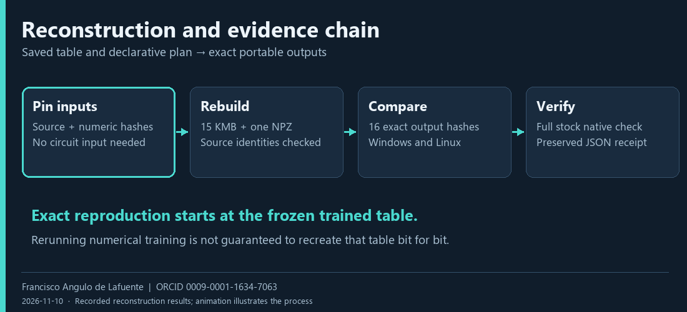
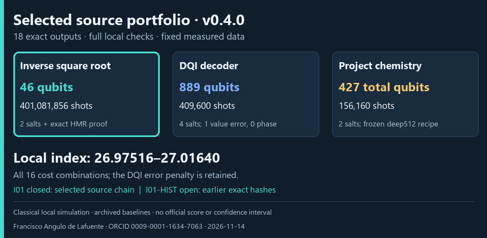
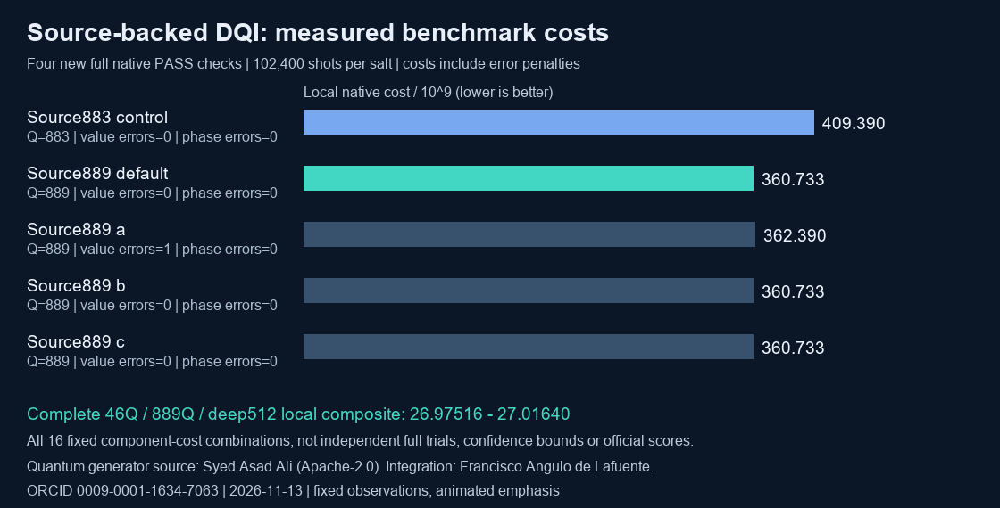
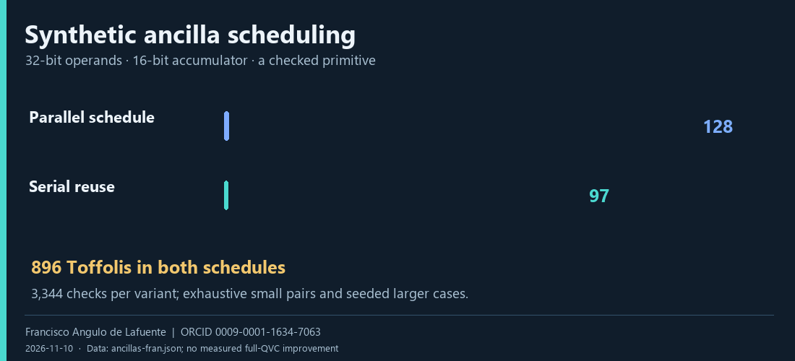

<p align="center"></p>

# QVC Chemistry Compiler

**Reproducible GF(2) angle loaders for the FeMoCo quantum-circuit benchmark.**

<!-- KAGGLE_V040_RESULT:START -->
## Kaggle submission · 14 November 2026

Kaggle completed submission **58344264** with public score **26.94027**, **+17.81%** versus this account's preceding **22.86842** result. [Receipt and verification](docs/KAGGLE_SUBMISSION_0_4_0.md). Sources are shared with all participants in the [official competition forum](https://www.kaggle.com/competitions/google-verifiable-quantum-circuit-compilation/discussion/759244).



<!-- KAGGLE_V040_RESULT:END -->

## Selected v0.4.0 · complete source portfolio

The new [46Q / 889Q / deep512 study](studies/source_portfolio889/README.md) builds all 18 submission files from authenticated sources and achieves **26.975–27.016 local composite**, **25.47–25.67% above source v0.3**, across all measured component-cost combinations. Four new DQI checks pass 409,600 shots; all error penalties are retained. The complete ZIP passes stock readers and receipt bindings. Promoted on 14 November 2026, this is the selected **v0.4.0** candidature. **I01 is closed for its complete source chain**; the two older exact hashes remain a separately documented **I01-HIST** research item. [Download the selected release](https://github.com/Agnuxo1/qvc-chemistry-compiler/releases/tag/v0.4.0) · [Selection and evidence](SELECTED_CANDIDATE.json).

## Complete compact inverse study · 13 November

The new [46-qubit inverse study](studies/compact_invsqrt46/README.md) integrates Syed Asad Ali's Apache-2.0 source generator with this project's existing source-backed DQI and chemistry. Two full inverse salts pass **401,081,856 shots**; the complete 18-file portfolio passes the stock input readers and package checks. Its **25.90064 local composite** improves on the earlier source v0.3 portfolio by **20.48%**. Sources, exact hashes, receipts and a scientific resource animation are included. This earlier 46Q/883Q study remains a versioned control; v0.4.0 selects the higher-performing 46Q/889Q portfolio above.

<!-- OPENCLAW-EVIDENCE-AT-A-GLANCE:START -->
<p><sub><strong>Why this project stands out — evidence at a glance</strong></sub></p>
<p><sub><strong>Distinctive value.</strong> The README reports a chemistry reference-to-cost ratio of 11.2346609× for the selected project artifact versus 11.2040924× for the public gengsr artifact, approximately 0.2728% higher for those pinned circuits. The preregistration also reports a full stock-verifier pass for an 87-qubit inverse-square-root source control. The underlying receipts were not independently examined. Sources: <a href="https://github.com/Agnuxo1/qvc-chemistry-compiler/blob/284c1533cdc7dc7daf017eb96f60dedc6afad520/README.md">README.md</a>, <a href="https://github.com/Agnuxo1/qvc-chemistry-compiler/blob/284c1533cdc7dc7daf017eb96f60dedc6afad520/evidence/experiments/invsqrt-PREREGISTRATION.md">evidence/experiments/invsqrt-PREREGISTRATION.md</a>.</sub></p>
<p><sub><strong>Scalability.</strong> Candidate resource counts are documented, but scaling with workload size or deployment volume has not been established; behavior beyond the tested configurations is unverified. Sources: <a href="https://github.com/Agnuxo1/qvc-chemistry-compiler/blob/284c1533cdc7dc7daf017eb96f60dedc6afad520/evidence/experiments/invsqrt-frontier-phase2.json">evidence/experiments/invsqrt-frontier-phase2.json</a>.</sub></p>
<p><sub><strong>Energy efficiency.</strong> Energy per equivalent completed task is not measured in the supplied evidence. Verifier and circuit-resource results do not establish energy savings.</sub></p>
<p><sub><strong>Speed.</strong> Recorded phase-two source builds took approximately 58.6–60.1 seconds. No matched end-to-end runtime comparison establishes a speed advantage. Sources: <a href="https://github.com/Agnuxo1/qvc-chemistry-compiler/blob/284c1533cdc7dc7daf017eb96f60dedc6afad520/evidence/experiments/invsqrt-frontier-phase2.json">evidence/experiments/invsqrt-frontier-phase2.json</a>.</sub></p>
<p><sub><strong>Reliability.</strong> The preregistration reports that the 87-qubit inverse-square-root source control passed a full stock check over 200,540,928 shots. The underlying receipt was not independently examined. The reported test does not establish operational availability or general production reliability. Sources: <a href="https://github.com/Agnuxo1/qvc-chemistry-compiler/blob/284c1533cdc7dc7daf017eb96f60dedc6afad520/evidence/experiments/invsqrt-PREREGISTRATION.md">evidence/experiments/invsqrt-PREREGISTRATION.md</a>.</sub></p>
<p><sub><strong>Research foundation.</strong> The inverse-square-root study records a fixed exploratory grid, frozen coefficients and angles, source hashes, and a full-verifier criterion for claiming improvement. It identifies Francisco Angulo de Lafuente and <a href="https://orcid.org/0009-0001-1634-7063">ORCID 0009-0001-1634-7063</a>; the supplied evidence does not establish a duration of research experience. Sources: <a href="https://github.com/Agnuxo1/qvc-chemistry-compiler/blob/284c1533cdc7dc7daf017eb96f60dedc6afad520/evidence/experiments/invsqrt-PREREGISTRATION.md">evidence/experiments/invsqrt-PREREGISTRATION.md</a>, <a href="https://github.com/Agnuxo1/qvc-chemistry-compiler/blob/284c1533cdc7dc7daf017eb96f60dedc6afad520/evidence/experiments/invsqrt-frontier-phase2.json">evidence/experiments/invsqrt-frontier-phase2.json</a>.</sub></p>
<p><sub><strong>Environmental impact.</strong> The supplied evidence does not assess environmental impacts, including manufacturing and lifecycle tradeoffs, or establish a reduction in environmental burden.</sub></p>
<p><sub><strong>Emissions.</strong> Greenhouse-gas emissions and specific air pollutants are not measured or estimated in the supplied evidence.</sub></p>
<p><sub><strong>Water use.</strong> Direct and indirect water use, including withdrawal and consumption, are not measured or estimated in the supplied evidence.</sub></p>
<!-- OPENCLAW-EVIDENCE-AT-A-GLANCE:END -->

Research by **Francisco Angulo de Lafuente** · [ORCID 0009-0001-1634-7063](https://orcid.org/0009-0001-1634-7063) · [Citation](CITATION.cff) · [License policy](docs/LICENSE_POLICY.md)

The selected chemistry achieves a **11.2346609× local cost reduction**, with **14,848 Toffolis and 427 qubits**, checked by the unmodified official verifier. The repository provides the frozen numeric table, a declarative GF(2) plan, source reconstruction and the receipts needed to examine that result. It also provides the selected, fully source-generated three-task portfolio. These are classical simulation results for the [Google Quantum AI competition](https://www.kaggle.com/competitions/google-verifiable-quantum-circuit-compilation).

## Measured chemistry



| Verified artifact | Reference/cost | Toffolis | Qubits |
|---|---:|---:|---:|
| Public 24.94 chemistry base | 11.1976101× | 14,966 | 427 |
| Public gengsr chemistry | 11.2040924× | 14,958 | 427 |
| Project s2 | 11.2298650× | 14,852 | 427 |
| **Project s37** | **11.2328903×** | **14,848** | **427** |
| Project H14 GPU | 11.2343975× | 14,848 | 427 |
| **Project deep GPU continuation** | **11.2346609×** | **14,848** | **427** |

The selected result improves the tested gengsr chemistry ratio by approximately **0.2728%**. Two full salts pass at 64 shots per lookup address. error_2 is **19.9784971 mHa**, leaving **0.0215029 mHa** below the 20 mHa ceiling. Comparisons apply to these pinned circuits. [Results and evidence](docs/RESULTS.md).

## GPU experiment



The latest GPU continuation used **4,096 states**, **42,001 steps** and **3,630 seconds**. It lowers actual native cost by a further **0.0023439%** against the preceding H14 result while preserving all fifteen angle circuits. Both final salts pass and all sixteen reconstructed output hashes match on Windows and Linux. The earlier 2,048-state run is retained. [Protocol, invariants and measured result](docs/GPU_EXPERIMENT.md).

## How the compiler works



The pipeline fits a credited DF-THC factorization, chooses a Givens tree and 8-bit words, and compiles the lookups with reusable Boolean features. Each emitted loader stays within 128 qubits. Exact reconstruction starts from the saved fitted table and optimized algebraic plan. It checks tensor identities, gauge equivalence and all expected output hashes. [Methods and equations](docs/METHODS.md).

## Reproduce and inspect



```bash
python -m pip install -r requirements.txt
python tools/build_chemistry.py build/chemistry --recipe recipes/h14-deep512 --data /path/to/official/data --runtime /path/to/native/runtime
python tools/verify_local.py chem build/chemistry build/receipt.json --data /path/to/official/data --runtime /path/to/native/runtime
python tools/check_repository.py
```

Use Python 3.13 and the competition's native Kickmix runtime and data. The expected build contains 15 circuits plus one NPZ, byte-identical to the saved manifest. [Full environment and three-task instructions](docs/REPRODUCIBILITY.md).

## Verification coverage



The selected portfolio binds **401,081,856 inverse shots across two salts**, **409,600 DQI shots across four salts**, and two **78,080-shot chemistry checks** to the exact generated files. The inverse also has a complete-domain HMR proof. Inverse and chemistry receipts are reused only after exact byte matches; the four DQI checks are new. One DQI value error is retained in the cost; all four checks pass. The **26.975–27.016** local range covers all 16 component-cost combinations, not independent joint trials, confidence bounds or Kaggle scores. [Measured evidence](studies/source_portfolio889/README.md).

## Complete source-generated portfolio



The selected source portfolio combines Syed Asad Ali's credited **46-qubit inverse** and **889-qubit DQI** generators with this project's **deep512 chemistry**. The complete constructor emits all eighteen exact files. Full native receipts, seventeen stock circuit readers, the NPZ reader, CRC/extraction and input-hash bindings pass. The checked ZIP and complete source bundle are in the [v0.4.0 release](https://github.com/Agnuxo1/qvc-chemistry-compiler/releases/tag/v0.4.0). [Build and package](docs/SOURCE_PORTFOLIO.md) · [Promotion record](docs/RELEASE_0_4_0.md).

## Recovered invsqrt mathematics

All **256 numerical coefficient triplets** and the two phase-readout rules have been recovered. An independent native comparison matches the original phase exactly on **all 3,133,452 legal inputs**, with one measured branch per input and restored input/scratch. A separate **88-qubit source construction** from those coefficients passes all **200,540,928 official shots**. The original 62-qubit circuit generator remains the reconstruction target. [Reconstruction study, source and precise verification scope](studies/recovered_invsqrt/README.md).

## A checked primitive experiment



A synthetic measurement-based carry experiment reduces its 32-bit example from **128 to 97 qubits**, retaining **896 Toffolis**. There are **3,344 checks per variant**, with exhaustive small domains and deterministic larger-word cases. This is a primitive result, not an end-to-end QVC gain. [Experiments and negative results](docs/EXPERIMENTS.md).

## Repository map

| Directory | Purpose |
|---|---|
| recipes | Original s37, H14 and selected deep GPU tables, rotations, GF(2) masks and expected hashes |
| tools | Portable reconstruction, native verification, checks and figure renderer |
| compiler, tables, trees | Project compiler, fitting, rounding and tree-search research |
| experiments, studies | Supporting experiments and diagnostic research scripts |
| vendor | Credited public pipeline and original notices |
| evidence | Original results, executed audit sources and replication records |
| docs | Methods, results, reproducibility, source recovery and attribution |

Research scripts preserve historical names; the documented tools are the portable entry points. [Research contributor](CONTRIBUTORS.md).

## Attribution and open source

Original project contributions: **Francisco Angulo de Lafuente**, [ORCID](https://orcid.org/0009-0001-1634-7063). Please cite [CITATION.cff](CITATION.cff) and retain copyright and license notices when reusing the work. Machine-readable authorship is also provided in [CodeMeta](codemeta.json) and SPDX source headers.

Original, separable project work is **MIT OR Apache-2.0**. The competition handover uses Apache-2.0; Apache-derived code and public components retain their original notices. The project builds on marculera/Lera's pipeline, heliosli's compiler idea and public work credited to qwertykeypadapple, Dmitrii Gluzdov, gengsr, maoxin123, Syed Asad Ali, Atakan Aldemir and other authors. [Full attribution](docs/ATTRIBUTION.md) · [NOTICE](NOTICE).

## Observations

**I01 is closed for selected v0.4.0**, following the explicit decision to promote the superior complete source candidate on 14 November 2026. **I01-HIST remains open** for reproducing the different original `26ebf39d…` inverse and `e9f54be3…` DQI hashes. Their generators have not been recovered; the historical files and evidence remain separately identified. An executable organizer-reference source control is also retained, with local composite approximately **2.239566**. [Source-recovery evidence](docs/SOURCE_RECOVERY.md).

Chemistry reconstructs exactly from saved inputs; deterministic retraining from the Hamiltonian is not established. The animations are rendered scientific illustrations of saved results or labelled schematics. The dated submission record reports the actual Kaggle receipt and any completed score; prize eligibility and quantum-hardware performance are not certified. [Competition and publication record](docs/COMPETITION.md).


---
Research author: **Francisco Angulo de Lafuente** · [ORCID](https://orcid.org/0009-0001-1634-7063) · 2026-11-10.
Own text: MIT OR Apache-2.0; third-party materials retain their notices.

<!-- author-background:start -->
## Author background

**Francisco Angulo de Lafuente**, independent AI researcher · [ORCID](https://orcid.org/0009-0001-1634-7063) · [arXiv](https://arxiv.org/a/angulodelafuente_f_1.html) · [Google Scholar](https://scholar.google.com/citations?user=6nOpJ9IAAAAJ) · [ResearchGate](https://www.researchgate.net/profile/Francisco-Angulo-Lafuente-3) · [Figshare](https://figshare.com/authors/Francisco_Angulo_de_Lafuente/22601234) · [Wikipedia](https://es.wikipedia.org/wiki/Francisco_Angulo_de_Lafuente)

Earlier research at ECOFA focused on biotechnology for clean energy and on second-generation biofuels obtained by microbiological processing of organic waste. Two Spanish patents document that work:

- **ES 2273594 B1**, *Process for obtaining fuels from organic waste*. Filed 5 September 2005, grant published 16 February 2008. [OEPM](https://www.oepm.es/pdf/ES/0000/000/02/27/35/ES-2273594_B1.pdf) · [Google Patents](https://patents.google.com/patent/ES2273594B1/en)
- **ES 2341194 B1**, *Method for obtaining paraffin by a biological process with microorganisms from organic matter, and its refining for use as fuel*. Filed 11 September 2007, grant published 26 April 2011. Also published as EP2196519 and WO2009034217. [OEPM](https://www.oepm.es/pdf/ES/0000/000/02/34/11/ES-2341194_B1.pdf) · [Google Patents](https://patents.google.com/patent/ES2341194B1/en)

These are historical publication and grant records under the inventor name Francisco Angulo Lafuente, and both have since lapsed. They are cited as evidence of a research trajectory and make no statement about current enforceability.
<!-- author-background:end -->
