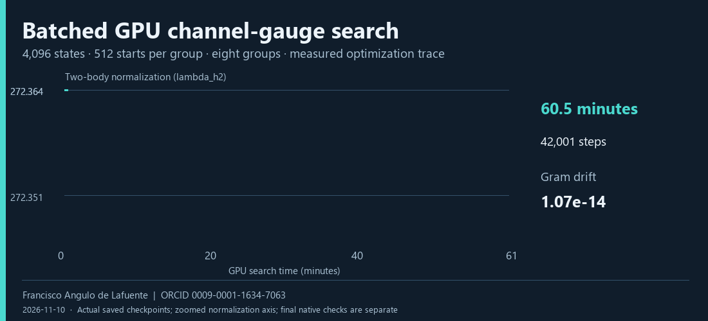

# H14: a measured GPU chemistry improvement

The 45-minute channel-gauge experiment improved the verified chemistry ratio from **11.2328903140x to 11.2343975372x**. Actual official cost decreased from **298,729,845.5264 to 298,689,767.4933**, a **0.0134161%** reduction. Both final salts passed the complete unchanged native check, with 78,080 shots each. Total resources remain 14,848 Toffolis and 427 qubits.



| Measured quantity | Result |
|---|---:|
| GPU | NVIDIA GeForce RTX 3090 |
| Main search | 58,962 steps; approximately 45 minutes |
| Concurrent search states | 256 per group x 8 groups = 2,048 |
| Global starts in each batch | 42 per group |
| Original s37 two-body normalization | 272.440410784982 |
| Continuation seed normalization | 272.406847692806 |
| Final normalization | 272.364345174517 |
| Final augmented-Gram drift | 7.1054e-15 |
| Final rotation orthogonality error | 1.9984e-15 |
| Final effective normalization | 47.111237352442 |
| One-body error | 11.1973581068 mHa |
| Two-body error | 19.9784971080 mHa |
| Exact source reconstruction | 16/16 output hashes match |

The transformation preserves the physical fitted tensors while reducing the one-norm-based normalization. It leaves all fifteen angle circuits unchanged. The mathematical model, finite-difference convergence check and pre-execution protocol are retained in [methods](METHODS.md) and `experiments/gauge`. The actual checkpoint trace, immutable source hash, seeds, environment and native receipt hashes are recorded under `evidence/experiments`. This scales the credited public orthogonal-gauge refinement idea; it does not claim invention of that idea.

## Reproduce the selected artifacts

```bash
python tools/build_chemistry.py build/h14-chemistry --recipe recipes/h14-main --data /path/to/official/data --runtime /path/to/native/runtime
python tools/verify_local.py chem build/h14-chemistry build/h14-a.json --data /path/to/official/data --runtime /path/to/native/runtime --salt independent-a
python tools/verify_local.py chem build/h14-chemistry build/h14-b.json --data /path/to/official/data --runtime /path/to/native/runtime --salt independent-b
```

The expected numerical ZIP-file SHA256 is `cfc6a3084b3c65bc3b74f57efda8da07776fa9ea5a1a4a8bc1b594f302233bc9`. The official verifier also reports a canonical array-content digest; that is a different identifier. The manifest binds the actual file bytes.

To repeat the search, install a suitable CUDA-enabled PyTorch in an isolated environment. The executed environment used Python 3.13.7, PyTorch 2.6.0+cu124, NumPy 2.5.4 and driver 581.29. Allocate one idle GPU through your compute scheduler before executing:

```bash
python experiments/gauge/gauge_search_v2.py --seed experiments/gauge/main-seed.npz --out build/new-gauge-run --wall-s 2700 --batch 256
```

The run emits a new rotation and fitted table. Use `tools/apply_channel_gauge.py --help` to construct a new numerical candidate with matching angle metadata, then run both full native checks. A new optimization result does not inherit the released candidate's PASS. The archived final recipe is the exact reproducibility boundary; repeated GPU optimization is not promised to be bitwise deterministic.

## Observations

The improvement is small and measured. The first pilot version lacked true global starts and a mandatory final flush; the reviewed v2 corrected both before the main run. The continuation seed required a central-difference step-size convergence study; the original tolerance was retained. These corrections and the negative arithmetic variants remain recorded. Local validation does not establish a Kaggle score, prize eligibility or quantum-hardware performance.

Research author: Francisco Angulo de Lafuente · ORCID https://orcid.org/0009-0001-1634-7063 · 2026-11-10. Own experiment and text: MIT OR Apache-2.0; upstream methods retain their attribution.
