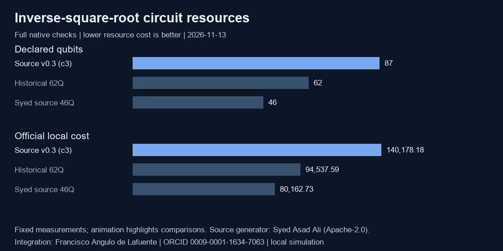

# Complete compact inverse-square-root generator



The complete **46-qubit** source generator passes the unmodified official verifier on **401,081,856 shots across two salts**. Integrated with the existing source-generated 883-qubit DQI policy and deep512 chemistry, it produces an 18-file portfolio with local composite **25.90064**, a **20.48% improvement** over this repository's selected source v0.3 portfolio. These are classical local simulation results using archived reference costs; they are not leaderboard scores.

Quantum generator: **Syed Asad Ali**, Apache-2.0. Integration, measurements and documentation: **Francisco Angulo de Lafuente**, [ORCID](https://orcid.org/0009-0001-1634-7063), 2026-11-13. Original integration code/text: MIT OR Apache-2.0. Preserve upstream attribution, [LICENSE](UPSTREAM_LICENSE) and [NOTICE](UPSTREAM_NOTICE). The figure animates emphasis over fixed measurements, not a simulated trajectory.

## Evidence

| Check | Result |
|---|---|
| Pristine source reconstruction | Two independent builds, identical SHA256 `321aff83636214196daa9cbc9dcc9c5e12a155bcff8d9989e98b8cee40935177` |
| Exact symbolic/native-text proof | All 3,133,452 legal inputs and all 1,297 HMR variables; input restored, scratch clear |
| Stock verifier, two full salts | Both PASS; 200,540,928 shots each; 46 qubits; 1 T; 33 rotations |
| Measured inverse cost | 80,162.73214111096 and 80,162.69658589501 |
| Worst error/tolerance | 0.973575996935943 at x=54566 |
| Complete portfolio | 18 source-built files ; 17 stock circuit readers, NPZ reader, ZIP CRC and receipt/input binding pass |

The exact expectation is 1511.5703125 Toffoli-like gates; native counts fluctuate with measurement branches. The source archive SHA256 is `7d9801ae20e942dba2211a656bba6014a0a16d57da534c0b60328d1c5d9d8254`. All 560 internal source hashes are checked. Raw native receipts, exact proof, build and package manifests are retained beside this README. The upstream source is archived in [invsqrt_source.zip](invsqrt_source.zip); its original [usage guide](UPSTREAM_README.md) remains available.

## Reproduce the complete construction

Requirements: Linux x86_64, CPython 3.13, NumPy, bash/core utilities and the competition's pinned native runtime and verifiers. Keep work paths free of whitespace and `@`; choose fresh output directories. The inverse build is bounded at 900 s; each full verifier run at 3600 s. Logs and work are retained on failure. No training, network download, GPU or SAT solver is needed.

```bash
python compact_invsqrt.py --engine HOST/kickmix --verifiers HOST/verifiers \
  --out /mnt/datos/inverse46 --work /mnt/datos/inverse46-work

python complete_portfolio.py --output /mnt/datos/portfolio46 --work /mnt/datos/portfolio46-work \
  --data HOST/data --runtime HOST/kickmix
```

The first command includes the exact proof and both full official salts. `--build-only` explicitly leaves an inverse result unqualified. The second builds all 18 files and requires their expected hashes; full receipt/package qualification is a separate finalization step. The 123-file DQI/chemistry source-and-receipt snapshot has a fixed root manifest hash and retains its original notices. Freshly built DQI and chemistry match their previous full native receipts exactly; their simulations were reused on that basis, not rerun in this study.

After observing the completed inverse execution report's SHA256, bind it explicitly when making the submission archive:

```bash
python finalize_candidate.py --candidate /mnt/datos/portfolio46 --output /mnt/datos/packaged46 \
  --native-root /mnt/datos/inverse46 --run-report-sha EXECUTION_REPORT_SHA256 \
  --metric HOST/metric-source.py --runtime HOST/kickmix
```

The finalizer checks names, command salts, full shot counts, file hashes and the execution-report root. The pinned audit hook must pass a real launch preflight and acknowledge generator activation/closure. Missing hooks, incomplete audit logs, duplicated/swapped receipts and incorrect salts are rejected by retained negative controls. The confirmed full wrapper run took465.671s; [execution evidence](confirmed-v2/integration-report.json), [audit activation controls](audit-activation-controls.json), [binding controls](binding-controls.json) and [package evidence](package/readiness.json) make these claims inspectable. Integrity hashes are not an external digital signature.

## Resolve physical data availability


The source reconstructs retired `a6` from the *current* derivative with one CCX and repays its HMR sign through a conditional Z. It never substitutes a mutated derivative into the earlier project's original-seed decoder. The complete program's proof covers this lifetime schedule. Readable T1/T2 donor component IR and loader certificates are upstream source inputs; they are disclosed, not claimed as this project's new synthesis. Bundled historical compiled research fixtures are read for authenticated length/hash checks at nine inspected sites. A pinned audit hook restricts those reads and rejects compiled circuit loading during generation; this bounded runtime audit is not an operating-system sandbox.

## Scope and status

The complete compact alternative is locally validated. Repository release v0.3 remains separately selected until a subsequent release promotion. No Kaggle submission or competition eligibility certification is asserted. Historical exact-source I01 remains **OPEN** for the different `26ebf39d…` inverse and `e9f54be3…` DQI hashes; this study does not relabel those artifacts or claim their original generators were recovered.

<!-- author-background:start -->
## Author background

**Francisco Angulo de Lafuente**, independent AI researcher · [ORCID](https://orcid.org/0009-0001-1634-7063) · [arXiv](https://arxiv.org/a/angulodelafuente_f_1.html) · [Google Scholar](https://scholar.google.com/citations?user=6nOpJ9IAAAAJ) · [ResearchGate](https://www.researchgate.net/profile/Francisco-Angulo-Lafuente-3) · [Figshare](https://figshare.com/authors/Francisco_Angulo_de_Lafuente/22601234) · [Wikipedia](https://es.wikipedia.org/wiki/Francisco_Angulo_de_Lafuente)

Earlier research at ECOFA focused on biotechnology for clean energy and on second-generation biofuels obtained by microbiological processing of organic waste. Two Spanish patents document that work:

- **ES 2273594 B1**, *Process for obtaining fuels from organic waste*. Filed 5 September 2005, grant published 16 February 2008. [OEPM](https://www.oepm.es/pdf/ES/0000/000/02/27/35/ES-2273594_B1.pdf) · [Google Patents](https://patents.google.com/patent/ES2273594B1/en)
- **ES 2341194 B1**, *Method for obtaining paraffin by a biological process with microorganisms from organic matter, and its refining for use as fuel*. Filed 11 September 2007, grant published 26 April 2011. Also published as EP2196519 and WO2009034217. [OEPM](https://www.oepm.es/pdf/ES/0000/000/02/34/11/ES-2341194_B1.pdf) · [Google Patents](https://patents.google.com/patent/ES2341194B1/en)

These are historical publication and grant records under the inventor name Francisco Angulo Lafuente, and both have since lapsed. They are cited as evidence of a research trajectory and make no statement about current enforceability.
<!-- author-background:end -->
