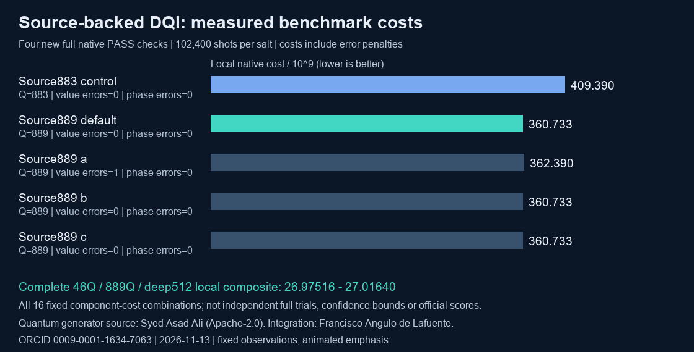
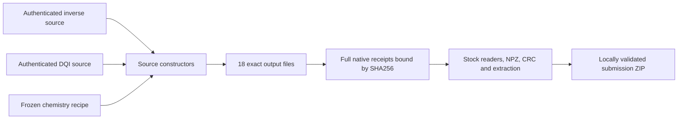

# Complete source portfolio: 46Q inverse, 889Q DQI, deep512 chemistry



This complete source reconstruction produces **18 submission files** and a locally validated composite of **26.97516–27.01640**, using all observed component-cost combinations. That is **25.47–25.67% above source v0.3**. All four new DQI stock-verifier checks pass; the archive passes all 17 circuit readers, the NPZ reader, CRC/extraction and exact receipt/input binding. These are classical local simulation results with archived reference costs, not leaderboard scores or confidence bounds.

Integration and documentation: **Francisco Angulo de Lafuente**, [ORCID](https://orcid.org/0009-0001-1634-7063), 2026-11-13, MIT OR Apache-2.0. The inverse and DQI source packages were published by **Syed Asad Ali under Apache-2.0**; preserve their copyright and notices. Chemistry retains this project's frozen optimization and the credited public recipe. This project does not claim to have invented Syed's quantum generators.

## Measured evidence

| Component | Native qubits | Full local evidence |
|---|---:|---|
| Inverse square root |46| Byte-identical to two confirmed 200,540,928-shot receipts; exact source proof covers all 3,133,452 legal inputs and HMR branches |
| DQI |889| Four new 102,400-shot checks, 409,600 shots total, all stock PASS |
| Chemistry |427| All 16 reconstructed files match two prior 78,080-shot checks |

The DQI observations retain every declared salt and the stock error penalty:

| Salt | Cost | Value errors | Phase errors |
|---|---:|---:|---:|
| default |360733280431.94055|0|0|
| a |362390008931.8864|1|0|
| b |360733130907.9235|0|0|
| c |360733156109.01373|0|0|

One value error occurred in salt A and is included in its higher cost. No zero-error or universal decoder-correctness claim is made. The 16 combinations use two inverse salts, four DQI salts and two chemistry salts; they are not 16 independent full-portfolio trials. Inverse and chemistry simulations were reused only after exact hashes matched. The corresponding underlying benchmark costs, raw receipts, build/guard/audit records and all 16 indices are retained in this directory. [Detailed experiment](EXPERIMENT.md) · [Package evidence](package/readiness.json).

## Reconstruct from source

Requirements: Linux x86_64, ordinary CPython 3.13, NumPy, bash/core utilities, the competition's pinned native runtime and original verifiers. No GPU, SAT solving, network download or model training is needed for reconstruction. Use fresh output/work directories without whitespace or `@`. Source generation retains logs and uses the upstream 4 GB memory reserve/guard for DQI. Host binaries are supplied separately, not redistributed here.

```bash
python construct_complete.py \
  --inverse-bundle upstream/inverse46-source.zip \
  --dqi-archive upstream/dqi_source.zip \
  --data HOST/data --runtime HOST/kickmix \
  --output /mnt/datos/qvc889-output --work /mnt/datos/qvc889-work
```

This command authenticates both source archives, 430 DQI source pins, the 123-input legacy snapshot root and the native host files. It constructs the three components, requires all 18 expected output hashes and emits a source-build report. It does not label a build alone as qualified. `qualify_complete.py` separately binds full native execution reports to the generated files and checks the submission ZIP using the pinned stock metric. The archived `run_lab.py` records the hardware-specific laboratory procedure; use the generic construction command above or the original [DQI build instructions](upstream/DQI_README.md) to reproduce the generator in another environment.

The source archives preserve readable mathematical certificates and component IR. The inverse package also retains historical research fixtures that are read only for authenticated length/hash checks; no compiled target circuit is loaded during source construction. Pinned audit hooks require actual process activation/closure and reject compiled-circuit loading. These are bounded runtime checks, not an OS sandbox or an external signature.



## Artifact identities and status

The complete ZIP has **49,338,223 bytes**, SHA256 `0059f20ad2b9822318c208d28093714ca0e9440271262387c5b1df0109d3b30e`. The generated inverse is `321aff83636214196daa9cbc9dcc9c5e12a155bcff8d9989e98b8cee40935177`; DQI is `7cbe8ecf6f6e9743529b574f019504bb1712ce06fbb570c719ce9d9e2c914cd9`. Chemistry remains the deep512 recipe with the same 16 input hashes as the previous release. The whole pipeline was freshly reconstructed and validated; it does not claim deterministic retraining from the Hamiltonian.

This is a separately identified evaluated alternative. The selected v0.3 release and its identity remain unchanged. Historical exact-source I01 remains **OPEN** for the different `26ebf39d…` inverse and `e9f54be3…` DQI artifacts. No Kaggle submission, official score, eligibility certification, prize or quantum-hardware result is claimed.

<!-- author-background:start -->
## Author background

**Francisco Angulo de Lafuente**, independent AI researcher · [ORCID](https://orcid.org/0009-0001-1634-7063) · [arXiv](https://arxiv.org/a/angulodelafuente_f_1.html) · [Google Scholar](https://scholar.google.com/citations?user=6nOpJ9IAAAAJ) · [ResearchGate](https://www.researchgate.net/profile/Francisco-Angulo-Lafuente-3) · [Figshare](https://figshare.com/authors/Francisco_Angulo_de_Lafuente/22601234) · [Wikipedia](https://es.wikipedia.org/wiki/Francisco_Angulo_de_Lafuente)

Earlier research at ECOFA focused on biotechnology for clean energy and on second-generation biofuels obtained by microbiological processing of organic waste. Two Spanish patents document that work:

- **ES 2273594 B1**, *Process for obtaining fuels from organic waste*. Filed 5 September 2005, grant published 16 February 2008. [OEPM](https://www.oepm.es/pdf/ES/0000/000/02/27/35/ES-2273594_B1.pdf) · [Google Patents](https://patents.google.com/patent/ES2273594B1/en)
- **ES 2341194 B1**, *Method for obtaining paraffin by a biological process with microorganisms from organic matter, and its refining for use as fuel*. Filed 11 September 2007, grant published 26 April 2011. Also published as EP2196519 and WO2009034217. [OEPM](https://www.oepm.es/pdf/ES/0000/000/02/34/11/ES-2341194_B1.pdf) · [Google Patents](https://patents.google.com/patent/ES2341194B1/en)

These are historical publication and grant records under the inventor name Francisco Angulo Lafuente, and both have since lapsed. They are cited as evidence of a research trajectory and make no statement about current enforceability.
<!-- author-background:end -->
